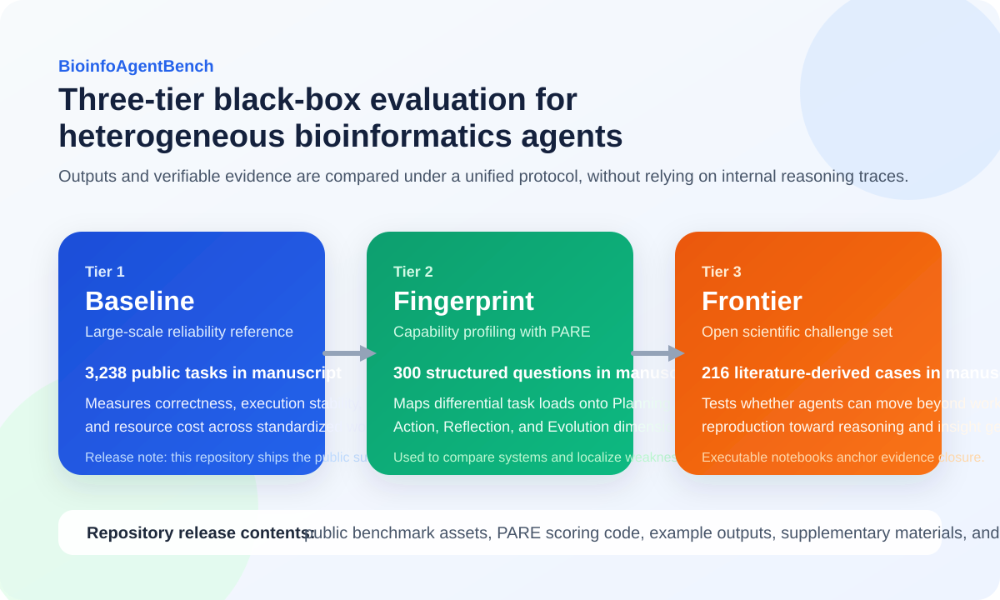

# BioinfoAgentBench

BioinfoAgentBench is a black-box benchmark for heterogeneous bioinformatics agents. It
evaluates agents across three progressive tiers: a large-scale Baseline Tier for
end-to-end reliability, a PARE-based Fingerprint Tier for capability profiling across
Planning, Action, Reflection, and Evolution, and a Frontier Tier of literature-derived
scientific challenges that probe the gap between workflow reproduction and open-ended
discovery.

This repository packages the public benchmark assets, evaluation code, example outputs,
and manuscript-facing release materials needed to inspect the framework and reproduce the
released evaluation bundle.

## Framework Overview



See the manuscript version in [Figure 1 (PDF)](paper/supplementary/Figure_1.pdf).

## What this repository contains

- `benchmarks/`: standardized benchmark JSON files, source collection subsets, and
  curated fingerprint upgrade packs.
- `src/bioinfoagentbench/`: PARE scoring engine plus benchmark standardization,
  validation, and manifest utilities.
- `paper/`: source spreadsheets and CSV files, result summaries, and committed
  supplementary tables and figures.
- `tools/pare_visualizer/`: static viewer for committed example PARE outputs.
- `examples/pare_outputs/`: example scoring outputs used by the visualizer.

## Important Release Scope Note

The manuscript describes a 3,238-task Baseline Tier. This public repository release does
not contain that full raw corpus. It contains the currently shareable subset packaged in
this release:

- 486 standardized baseline/fingerprint-ready records across 8 benchmark sources
- 8 fingerprint upgrade packs, each with 5 transformed BioMed-AQA records
- frontier curation tables, supplementary results, and pilot metadata

See [RELEASE_SCOPE.md](RELEASE_SCOPE.md) for the exact release boundary.

## Quick start

```bash
python -m venv .venv
```

Activate the environment on macOS / Linux:

```bash
source .venv/bin/activate
```

Activate the environment on Windows PowerShell:

```powershell
.venv\Scripts\Activate.ps1
```

Install and validate:

```bash
pip install -e .[dev]
pytest
biab-validate
```

Run a single PARE scoring job:

```bash
pare-eval --bench biodsbench --record-id biodsbench_28481359_0 --dry-run
```

Batch-score one or more benchmarks:

```bash
pare-eval-batch --bench autoba biochatter --dry-run
```

Regenerate the benchmark manifest:

```bash
biab-manifest
```

Launch the visualizer locally:

```bash
cd tools/pare_visualizer
python -m http.server 8090
```

Then open `http://127.0.0.1:8090`.

## Online visualizer

The repository includes a GitHub Pages workflow at
`.github/workflows/deploy-visualizer.yml`. After pushing the repository to GitHub:

1. Open `Settings -> Pages`.
2. Set `Source` to `GitHub Actions`.
3. Push to `main` or manually run the `Deploy PARE Visualizer` workflow from `Actions`.

The workflow rebuilds `tools/pare_visualizer/data/scores_index.json` from
`examples/pare_outputs/` and publishes `tools/pare_visualizer/` as a static site.
If you prefer fully automatic first-time enablement, add a repository secret named
`PAGES_TOKEN` backed by a Personal Access Token with repository/pages write access; the
workflow will then try to enable Pages for the repository on its own.

## Repository layout

- [benchmarks/README.md](benchmarks/README.md)
- [docs/benchmark_tiers.md](docs/benchmark_tiers.md)
- [paper/README.md](paper/README.md)
- [tools/pare_visualizer/README.md](tools/pare_visualizer/README.md)
