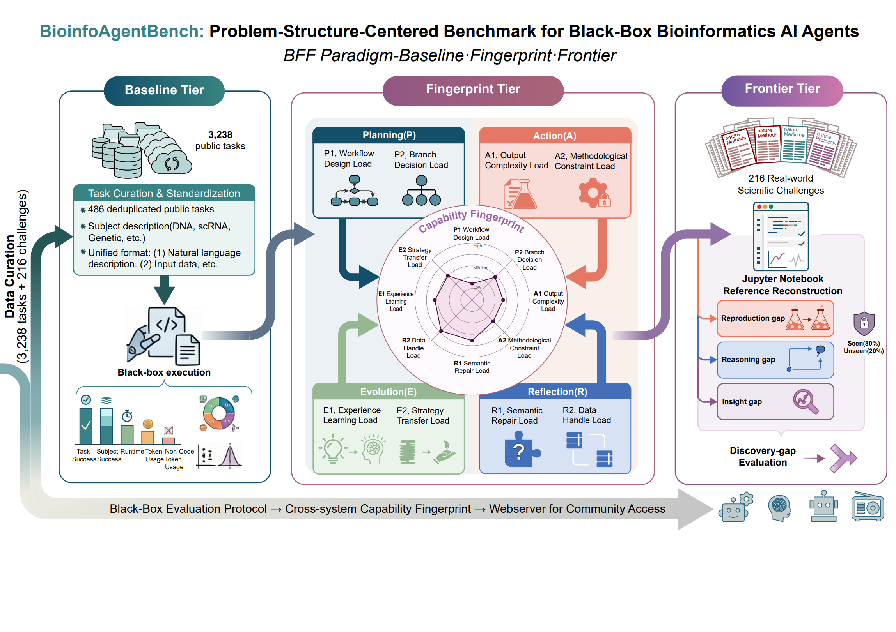

# BioinfoAgentBench

BioinfoAgentBench is a unified black-box evaluation framework for heterogeneous bioinformatics agents. It is organized into three progressive tiers: the Baseline Tier uses large-scale standardized public tasks to assess end-to-end reliability, the Fingerprint Tier uses structurally tuned questions to construct capability fingerprints across the Planning, Action, Reflection, and Evolution (PARE) dimensions, and the Frontier Tier introduces literature-derived scientific challenges to evaluate the gap between workflow reproduction and open-ended scientific discovery.

This repository packages the public benchmark assets, evaluation code, example outputs, and manuscript-facing release materials needed to inspect the framework and reproduce the released evaluation bundle.

## Framework Overview



See the manuscript version in [Figure 1 (PDF)](paper/supplementary/Figure_1.pdf).

## What this repository contains

- `benchmarks/`: standardized benchmark JSON files, source collection subsets, and curated fingerprint upgrade packs.
- `src/bioinfoagentbench/`: PARE evaluation utilities plus benchmark standardization, validation, and manifest utilities.
- `paper/`: source spreadsheets and CSV files, result summaries, and committed supplementary tables and figures.
- `tools/pare_visualizer/`: static viewer for committed PARE capability fingerprints and example outputs.
- `examples/pare_outputs/`: example scoring outputs used by the visualizer.

## Important Release Scope Note

The manuscript describes a 3,238-task Baseline Tier. This public repository release does not contain that full raw corpus. It contains the currently shareable subset packaged in this release:

- 486 standardized Baseline Tier tasks across 8 released source collections
- 8 Fingerprint Tier upgrade packs, each with 5 transformed BioMed-AQA questions
- frontier curation tables, supplementary results, and pilot metadata

## Quick start

```bash
python -m venv .venv
```

Activate the environment on macOS / Linux:

```bash
source .venv/bin/activate
```

Activate the environment on Windows PowerShell:

```powershell
.venv\Scripts\Activate.ps1
```

Install and validate:

```bash
pip install -e .[dev]
pytest
biab-validate
```

Run a single PARE scoring job:

```bash
pare-eval --bench biodsbench --record-id biodsbench_28481359_0 --dry-run
```

Batch-score one or more benchmarks:

```bash
pare-eval-batch --bench autoba biochatter --dry-run
```

Regenerate the benchmark manifest:

```bash
biab-manifest
```

Launch the visualizer locally:

```bash
cd tools/pare_visualizer
python -m http.server 8090
```

Then open `http://127.0.0.1:8090`.

## Repository layout

- [benchmarks/README.md](benchmarks/README.md)
- [docs/benchmark_tiers.md](docs/benchmark_tiers.md)
- [paper/README.md](paper/README.md)
- [tools/pare_visualizer/README.md](tools/pare_visualizer/README.md)
