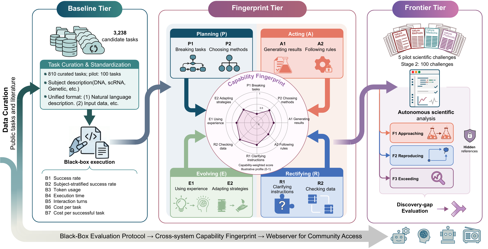

# BioinfoAgentBench

BioinfoAgentBench provides a unified framework for evaluating bioinformatics agents across task completion, agent capabilities, and scientific problem solving. Its three tiers—Baseline, Fingerprint, and Frontier—connect broad task evaluation with capability diagnosis and research-oriented challenges. The framework characterizes agent capabilities through Planning, Acting, Rectifying, and Evolving (PARE).

## Benchmark overview



| Tier | Scale | Focus |
|---|---:|---|
| Baseline | 810 tasks | Task correctness and end-to-end reliability |
| Fingerprint | 100 tasks | Planning, Acting, Rectifying, and Evolving capabilities |
| Frontier | 5 scientific cases | Scientific analysis and problem solving |

See [benchmark materials](benchmarks/README.md) for task descriptions, input data and evaluation criteria.

## Repository structure

```text
benchmarks/    Task definitions, data and evaluation materials
configs/       Pilot configuration
src/           Task export, scoring and metric aggregation
optimization/  AutoBA and BioMaster code snapshots and patches
paper/         Figures and supplementary tables
pyproject.toml Python package configuration
```

## Quick start

Requires Python 3.10 or later.

**1. Install the package.**

```sh
git clone https://github.com/BOBQWERA/BioinfoAgentBench.git
cd BioinfoAgentBench
python -m venv .venv
source .venv/bin/activate
python -m pip install -e .
```

**2. Export the 100-task Baseline pilot.**

```sh
bioinfoagentbench tasks --tier baseline --pilot --output task_inputs.jsonl
mkdir -p run
```

**3. Run the tasks and record evaluation judgments.**

Give your agent each exported task and its corresponding input files, and save the outputs under `run/`. Review the outputs against each task's `verification_rules` in `benchmarks/baseline/tasks.jsonl`. Save one judgment per task and agent in `judgments.jsonl`, with evidence paths relative to `run/`.

Use one JSON object per line. For example, after verifying that the agent's `run/BL-0251/answer.txt` reports `0.05`:

```jsonl
{"task_id":"BL-0251","agent":"my-agent","all_rules_reviewed":true,"checks":[{"criterion":"Median treeness difference: fungi minus animals","passed":true,"reason":"The reported difference is 0.05.","evidence":[{"path":"BL-0251/answer.txt","quote":"0.05"}]}]}
```

Include checks for every verification rule, set `all_rules_reviewed` to `true` after completing the review, and supply records for all 100 pilot tasks per agent. Each passing check needs an existing evidence file and a matching `quote` or a `locator` describing its location.

**4. Score the judgments and summarize the results.**

```sh
bioinfoagentbench score --tier baseline --pilot --records judgments.jsonl --evidence-root run/ --output scored.jsonl
bioinfoagentbench summarize --tier baseline --pilot --records scored.jsonl --output summary.json
cat summary.json
```

The summary reports success rates by agent and subject, along with token usage, runtime, model requests and costs when supplied in the records.

## License

BioinfoAgentBench code is licensed under the [MIT License](LICENSE). Third-party code and data retain their original licenses.
